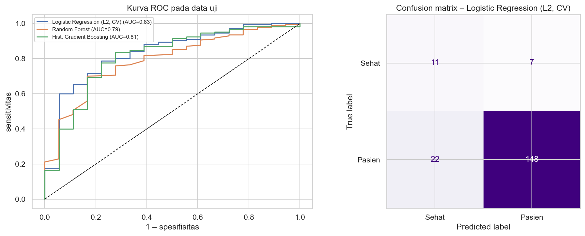
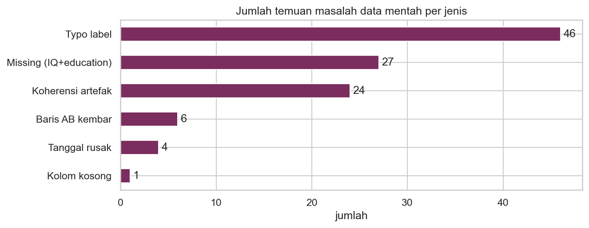
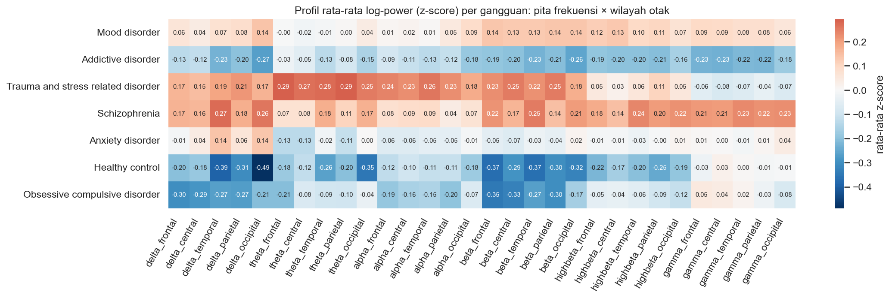

# Analisis EEG Pasien Gangguan Psikiatri

Pipeline analisis data end-to-end pada data EEG 945 pasien gangguan psikiatri dan kontrol sehat: pembersihan data, analisis statistik, regresi, dan prediksi, dengan seluruh keputusan teknis diuji dan didokumentasikan.

**Pertanyaan yang dijawab**
1. Seberapa kotor data mentah, dan bagaimana menanganinya secara terukur?
2. Pita frekuensi dan area otak mana yang berbeda antara kontrol sehat dan pasien?
3. Faktor apa yang menjelaskan IQ, dan apakah EEG menambah daya prediksi?
4. Seberapa baik EEG memprediksi status sehat vs pasien dan jenis gangguan?

> Proyek ini bersifat analitik/akademik dan **bukan alat diagnosis klinis**.

## Hasil Utama

| Pertanyaan | Temuan |
|---|---|
| Kualitas data | 8 masalah ditemukan dan ditangani; 945 × 1.149 menjadi 939 × 1.152 tanpa missing pada fitur |
| Sehat vs pasien (EEG) | AUC ≈ 0,78 (validasi silang), signifikan pada uji permutasi (p ≈ 0,01) |
| Jenis gangguan (7 kelas) | Akurasi 30% vs 28% baseline: praktis tidak lebih baik dari menebak; hanya gangguan adiktif cukup terdeteksi (AUC ≈ 0,68) |
| Prediksi usia / IQ dari EEG | Tidak dapat diprediksi (R² ≈ 0) |
| IQ dari pendidikan, usia, jenis kelamin, diagnosis | R² validasi silang ≈ 0,25; menambah fitur EEG tidak membantu |
| Fitur EEG yang berbeda | 13 dari 30 fitur pita × wilayah berbeda signifikan (koreksi FDR) |

Hasil negatif dilaporkan apa adanya: sinyal EEG di data ini cukup untuk membedakan sehat vs pasien secara umum, tetapi tidak untuk membedakan jenis gangguan.



## Data

Dataset *EEG machine learning data BRMH* (Kaggle): 945 pasien, 7 kelompok diagnosis utama (termasuk kontrol sehat).

| Kolom | Jumlah | Isi |
|---|---|---|
| Metadata | 8 | ID, jenis kelamin, usia, tanggal EEG, pendidikan, IQ, diagnosis |
| `AB.*` | 114 | *Absolute power*: 19 elektroda × 6 pita frekuensi |
| `COH.*` | 1.026 | *Coherence*: 171 pasangan elektroda × 6 pita frekuensi |

Data bersifat *wide* (1.140 fitur untuk 939 pasien), sehingga memerlukan regularisasi dan validasi yang hati-hati.

## Metode

**1. Pembersihan data.** Setiap masalah dicatat beserta tindakan dan dampaknya.

| Masalah | Tindakan |
|---|---|
| Kolom kosong 100% | Dihapus |
| Nama kolom tidak konsisten | Diubah ke snake_case |
| Typo label (46 baris) | Dikoreksi |
| 4 format tanggal rusak | Diparse ulang |
| 3 pasang pasien dengan 114 nilai EEG identik (1 pasang berlabel konflik) | 6 baris dibuang |
| 24 nilai koherensi = 100% (artefak) | Diimputasi median |
| Missing IQ (12) dan pendidikan (15) | Imputasi median + kolom penanda |
| Distribusi power sangat miring (skew 3,37) | Transformasi log10 (skew menjadi 0,17) |

Strategi outlier dipilih lewat pengujian, bukan asumsi:

| Strategi | AUC sehat vs pasien |
|---|---|
| Data mentah | 0,752 |
| **log10 (dipilih)** | **0,770** |
| log10 + winsorize | 0,770 |



**2. Analisis.** Uji Kruskal-Wallis, Mann-Whitney dengan koreksi Benjamini-Hochberg, dan PCA.

**3. Regresi.** OLS untuk interpretasi koefisien; perbandingan Linear, Ridge, Lasso, Random Forest, dan Gradient Boosting dengan validasi silang.

**4. Prediksi.** Logistic Regression ter-regularisasi (L2) dengan validasi silang bersarang, dibandingkan dengan Random Forest dan Gradient Boosting. Evaluasi memakai AUC, uji permutasi, dan bootstrap. Prediksi per gangguan memakai skema one-vs-rest.



## Karakteristik Data (Big Data)

| Aspek | Kondisi |
|---|---|
| Volume | ≈ 1,07 juta nilai (~10 MB); simulasi 100.000 pasien diproses per-chunk |
| Velocity | Rekaman 2011–2019; prediksi ±50 pasien/detik (satuan) hingga ±50.000/detik (batch) |
| Variety | Kategorikal, numerik, tanggal, spektral (114), konektivitas (1.026) |
| Veracity | Kolom kosong, missing, tanggal rusak, baris kembar, artefak: ditangani |
| Value | Menguji kegunaan EEG sebagai pendukung skrining beserta batasannya |

Dataset besar pada jumlah fitur, tetapi kecil pada jumlah baris. Simulasi skala dibuat dengan Python, bukan Spark/Hadoop.

## Struktur Repositori

```
.
├── data/
│   ├── raw/        # data mentah (tidak diubah)
│   └── clean/      # data bersih dan ringkasan untuk dashboard
├── figures/        # grafik hasil analisis
├── UAS_EEG_BigData.ipynb
├── UAS_EEG_BigData.py
└── requirements.txt
```

| Berkas di `data/clean/` | Isi |
|---|---|
| `eeg_clean_full.csv` | Data bersih lengkap (939 × 1.152) |
| `eeg_clean_summary.csv` | Satu baris per pasien: demografi, 30 fitur ringkas, prediksi model |
| `eeg_band_region_long.csv` | Format panjang pasien × pita × wilayah, untuk dashboard BI |

## Menjalankan

```bash
git clone https://github.com/<username>/<nama-repo>.git
cd <nama-repo>
pip install -r requirements.txt
jupyter notebook UAS_EEG_BigData.ipynb
```

Jalankan seluruh sel; folder `data/clean/` dan `figures/` terisi otomatis (±1–3 menit). Butuh Python 3.10+.

## Keterbatasan

- Data satu institusi, tanpa validasi eksternal.
- Hanya 92 kontrol sehat setelah cleaning, sehingga ketidakpastian AUC lebar (AUC uji 0,83; CI bootstrap 95%: 0,73–0,92).
- Kontrol sehat berbeda usia dan IQ dari pasien, sehingga sebagian kemampuan klasifikasi dapat mencerminkan perbedaan kelompok.
- Pengaruh obat-obatan terhadap EEG tidak tercatat.
- Regresi bersifat asosiasi, bukan sebab-akibat.
- Pembuangan 6 baris EEG kembar adalah penilaian analis dan tidak dapat diverifikasi ke sumber data.

## Sumber

Dataset: *EEG.machinelearning_data_BRMH* (Kaggle); periksa ketentuan lisensi pada halaman dataset sebelum redistribusi.

## Penulis

Rafi Geraldy Krisnugraha, Sistem Informasi, Universitas Singaperbangsa Karawang